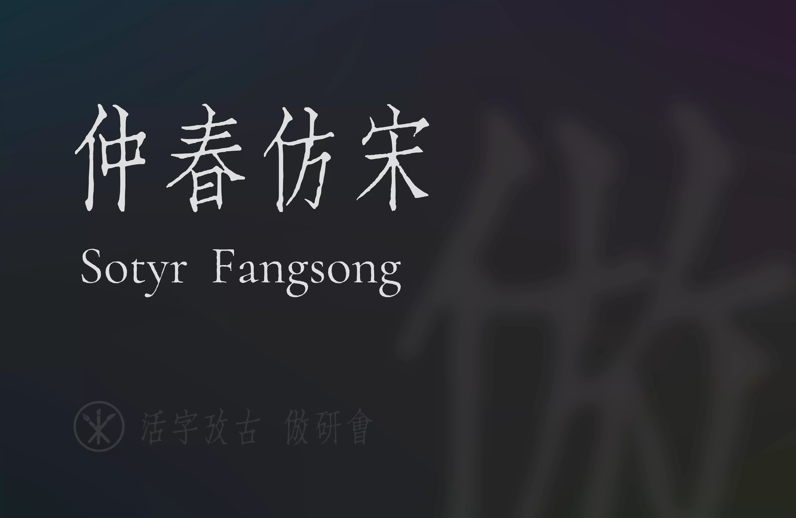
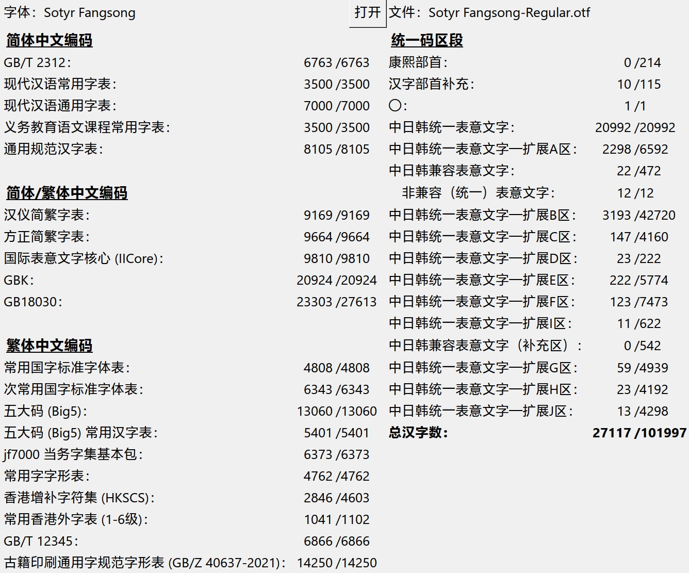
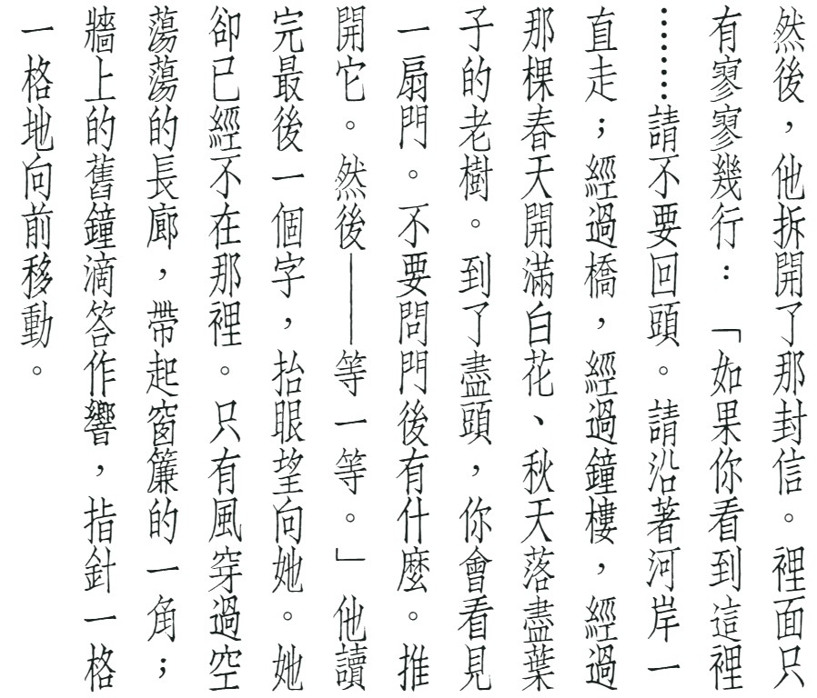
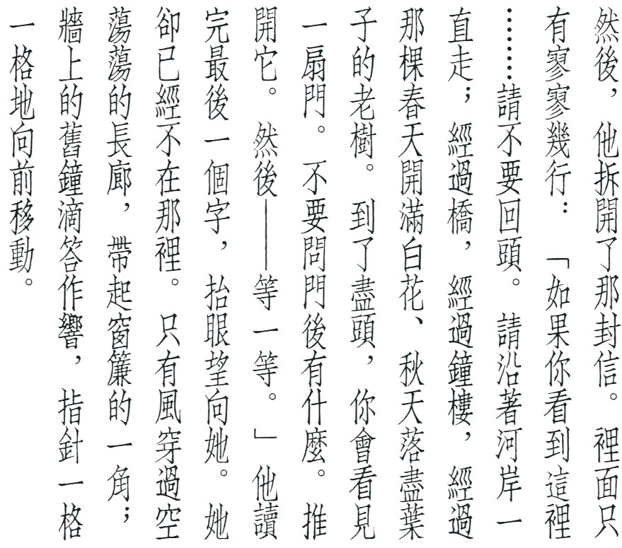
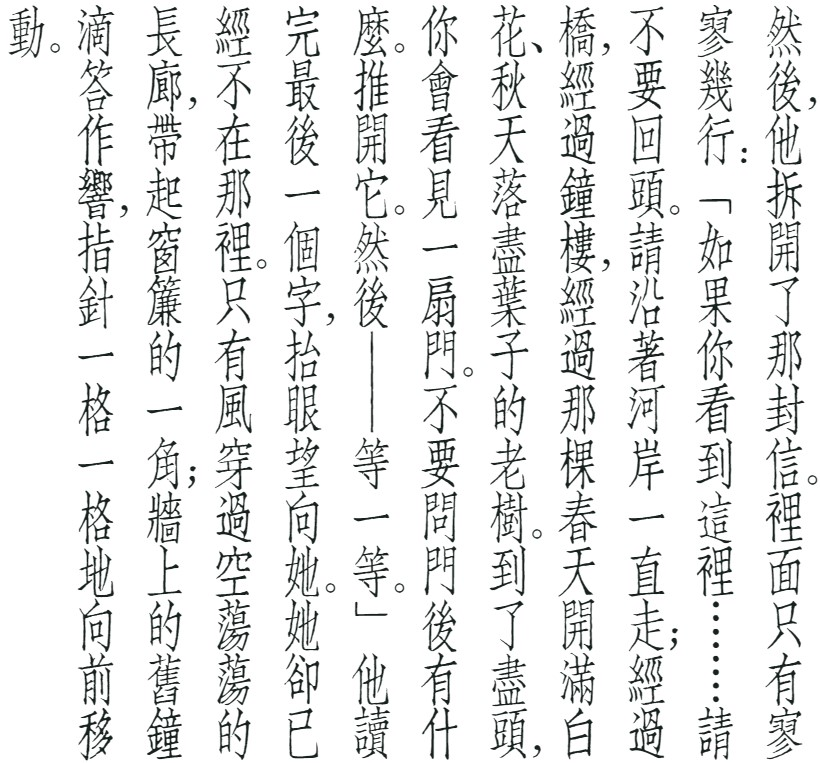
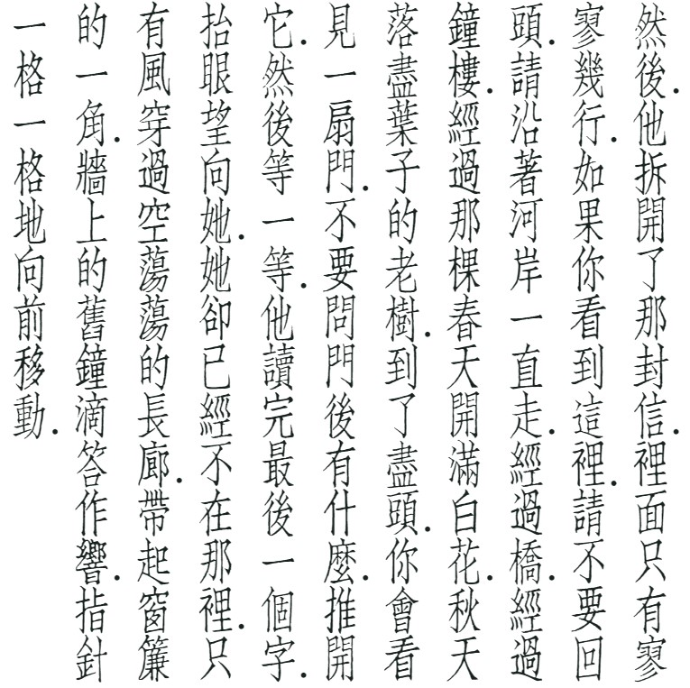
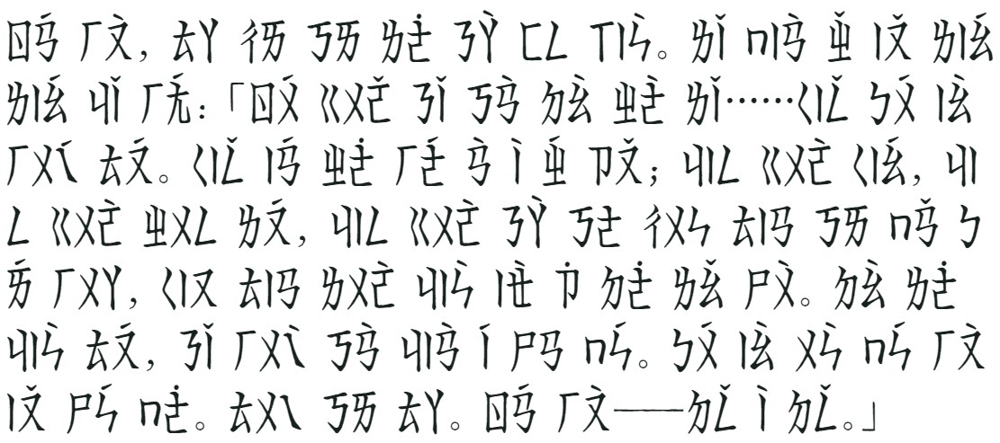
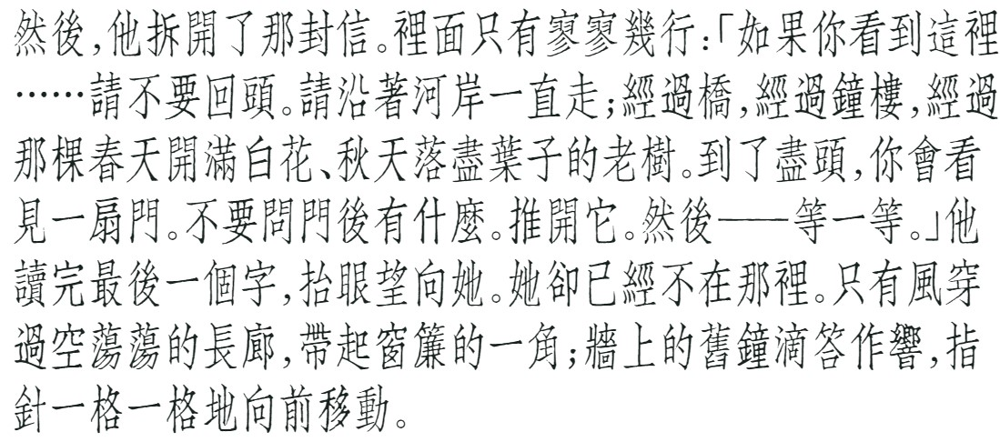

# 仲春仿宋

[繁體中文](docs/README_TC.md) | [漢文](docs/README_OC.md)

> **基本信息** 
> **名称**：仲春仿宋（Sotyr Fangsong） 
> **当前版本**：v0.23-beta 
> **风格**：仿宋体（Souchoutai） 
> **笔形**：普通印刷老笔形 

「仲春仿宋」是对上世纪聚珍仿宋二号长体铅活字字形进行的数字化项目。字形底本采用直接复刻的方式从印刷品扫描件中提取，后期还使用 [zi2zi-JiT](https://github.com/kaonashi-tyc/zi2zi-JiT) 与 [HanziGen](https://github.com/wangwenho/HanziGen) 两个项目生成缺少的字形。

**项目尚处于开发和测试阶段**，其中的缺字、丑字不少，还希望各界朋友多多包涵、提出宝贵意见。

- **排版案例**：[前往查看](https://forum.han-zi.top/d/122)

## 收字范围

下图为 [CJK-character-count](https://github.com/NightFurySL2001/CJK-character-count) 工具统计的收字范围。

## 下载与使用

仲春仿宋提供 `.ttf` 格式的字体文件。

请至：[Releases 页面](https://github.com/Hulenkius/sotyr/releases)

## OpenType 特性

| 特性 | 说明 |
| --- | --- |
| `vert` | 文本竖排，CJK 标点符号居中 |
| `kern` | 拉丁-数字以及横排 CJK 标点符号的字距调整 |
| `vkrn` | 竖排 CJK 标点符号的字距调整（谨慎使用） |
| `ss01` | 在竖排文本中，CJK 标点符号位于行内的字面右上角 |
| `ss02` | 在竖排文本中，CJK 标点符号位于行间的字形右下方 |
| `cv01` |  `ss02` 开启时，采用符合聚珍长二号原风格的古籍标点 |
| `cv02` | 采用符合聚珍长二号原风格繁体用字习惯 |
| `ss03` | 在横排文本中，使注音符号的声调标在注音的上方 |
| `ss04` | 在横排文本中，使用半角标点代替全角标点 |

对于古籍排版，我们十分推荐开启 `vert`、`cv02`、`ss02` 三个特性，可以获得十分接近聚珍仿宋二号长体原风格的排版效果。

特性预览：

| 特性 | 预览 |
| --- | --- |
| `vert` |  |
| `ss01` |  |
| `ss02` |  |
| `cv01` |  |
| `cv02` |  |
| `ss03` |  |
| `ss04` |  |

## 开发故事

若论哪套长体仿宋最为著名？熟谙近现代印刷史的同志，恐怕大都会脱口而出「聚珍仿宋」。不过聚珍仿宋的长体铅字自身又包含多种字号，哪一种最具代表性？这个问题的答案或许在同志们的脑海中能浮现出，但落实到具体字号层面，就不那么好回答了。

聚珍仿宋二号长体铅字，造型妍美多姿，而又因其字号适中，常应用于正文排版而不是标题和夹注。相比于头号字的直健、三号四号字的间架异化处理、五号字的细密，二号字的字形可以说是最丰富地展现了聚珍仿宋家族的风味。同时，上世纪末，聚珍仿宋二号长体经过史云鹏的大力推广，成为了工程类制图常用的手写体。工科出身的朋友们，你们当年有没有练习过呢？

聚珍的头号方体长体、二号方体，市面已有产品，而尚无二号长体产品可用。

在印刷品样本方面，现在开放的电子化扫描件非常多了，缺少的只是对其中的字形进行提取封装的工作。这个工作量不小，所以从 2025 年 1 月开始，我们又合作开发了一种切片工具和一种封装前处理工具，效率大为提升，小组内的同志们拊掌称奇。

v0.16-beta 版本发布后，设计界和出版界的朋友们以及字体爱好者网友有不少来围观的。看到仲春仿宋在艺术展览、书籍出版、餐饮广告等场景中的应用，开发团队感到非常高兴。大家也提出了很多宝贵的意见，希望仲春仿宋尽快完善。

特里王和宇宙微光同志提出：现在人工智能日新月异，图像生成技术迅猛发展，字形的生成和修复借助 AI 技术，能够大幅提高效率，何不尝试一番呢？结果十分惊人，[zi2zi-JiT](https://github.com/kaonashi-tyc/zi2zi-JiT) 和 [HanziGen](https://github.com/wangwenho/HanziGen) 两个项目如快马加鞭，生成了近一万八千个缺字：补字的效率，向前跃进了一大步！但同时也有新的问题：AI 生成的字形，当字形复杂时，生成的结果往往构形模糊、笔画错误、几乎不能辨识。从事仿宋字手写八年多的 hulenkius 同志，使用数位板修改、绘制了近六千个字形，才使得 v0.22-beta 版本的字形基本满足了朋友们的使用需求。

总之，「仲春仿宋」是传统汉字美学、印刷和数字化技术、新生产力结合的产物。

更多阅读：
- [《聚珍长二号杂说》](https://vistudium.top/2025/03/14/juzhen-L2/)
- [切片封装工具](https://vistudium.top/gouken/)

> **问**：「为什么要叫『仲春』」呢？ 
> **答**：这个项目是乙巳年仲春开始进行的。此外「仲」有「排行第二」的意思，而「春」的声符「屯」又有「聚集」的意思；二者结合，与「聚珍二号」暗应。「\*SO-TYN」是「聚珍」的谐声域，而汉代常常用 *-n 对译西域诸国语言的 *-r ，所以采用了「Sotyr」这个简洁而富有深意的名称。

## 开发人员

[活字攷古](https://github.com/hantype)社群 仿宋体研究小组

**执刀**：hulenkius

**顾问**：特里王，Basic低手，南池子，GitHub Copilot，DeepSeek Harness

## 捐赠慰问

您可以通过「爱发电」平台对本项目进行捐助：

https://afdian.com/a/hulenkius

## 许可证

本字体采用 [SIL Open Font License 1.1](https://scripts.sil.org/cms/scripts/page.php?site_id=nrsi&item_id=OFL_web) 许可证发布。

西文、阿拉伯数字和半角标点，基于 [Cormorant](https://github.com/CatharsisFonts/Cormorant) 修改而来，其许可证书同样是 [SIL Open Font License 1.1](https://scripts.sil.org/cms/scripts/page.php?site_id=nrsi&item_id=OFL_web)。

## 贡献者须知

本项目通过 FontCreator 进行开发，「.ufo」格式的数据是从 FontCreator 导出的。因此，如果有希望参与开发的同志，请致信商讨相关合作事宜，从源头进行协助，**勿直接发 Pull Request**。

- **开发人员信箱**：hulenkius@gmail.com