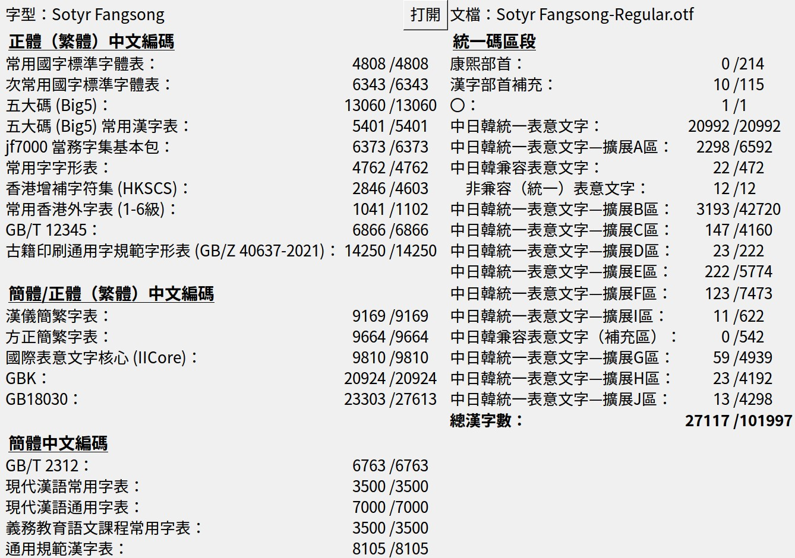

# 仲春仿宋

[简体中文](README_SC.md) | [漢文](README_OC.md)

> **基本信息** 
> **名稱**：仲春仿宋（Sotyr Fangsong） 
> **當前版本**：v0.22-beta 
> **風格**：仿宋體（Souchoutai） 
> **字形**：通用傳承字形 

「仲春仿宋」是對上世紀聚珍仿宋二號長體鉛活字字形進行的數字化項目。字形底本採用直接復刻的方式從印刷品掃描件中提取，後期還使用 [zi2zi-JiT](https://github.com/kaonashi-tyc/zi2zi-JiT) 與 [HanziGen](https://github.com/wangwenho/HanziGen) 兩個項目生成缺少的字形。

**項目尚處於開發和測試階段**，其中的缺字、醜字不少，還希望各界朋友多多包涵、提出寶貴意見。

- **排版案例**：[前往查看](https://forum.han-zi.top/d/122)

## 收字範圍

下圖爲 [CJK-character-count](https://github.com/NightFurySL2001/CJK-character-count) 工具統計的收字範圍。

## 下載與使用

仲春仿宋提供 `.ttf` 格式的字型檔。

請至：[Releases 頁面](https://github.com/Hulenkius/sotyr/releases)

## OpenType 特性

| 特性 | 說明 |
| --- | --- |
| `vert` | 文本豎排，CJK 標點符號居中 |
| `kern` | 拉丁-數字以及橫排 CJK 標點符號的字距調整 |
| `vkrn` | 豎排 CJK 標點符號的字距調整（謹慎使用） |
| `ss01` | 在豎排文本中，CJK 標點符號位於行內的字面右上角 |
| `ss02` | 在豎排文本中，CJK 標點符號位於行間的字形右下方 |
| `cv01` |  `ss02` 開啓時，採用符合聚珍長二號原風格的古籍標點 |
| `cv02` | 採用符合聚珍長二號原風格繁體用字習慣 |
| `ss03` | 在橫排文本中，使注音符號的聲調標在注音的上方 |
| `ss04` | 在橫排文本中，使用半形標點代替全形標點 |

對於古籍排版，我們十分推薦開啓 `vert`、`cv02`、`ss02` 三個特性，可以獲得十分接近聚珍仿宋二號長體原風格的排版效果。

特性預覽：

| 特性 | 預覽 |
| --- | --- |
| `vert` |  |
| `ss01` |  |
| `ss02` |  |
| `cv01` |  |
| `cv02` |  |
| `ss03` |  |
| `ss04` |  |

## 開發故事

若論哪套長體仿宋最爲著名？熟諳近現代印刷史的同志，恐怕大都會脫口而出「聚珍仿宋」。不過聚珍仿宋的長體鉛字自身又包含多種字號，哪一種最具代表性？這個問題的答案或許在同志們的腦海中能浮現出，但落實到具體字號層面，就不那麼好回答了。

聚珍仿宋二號長體鉛字，造型妍美多姿，而又因其字號適中，常應用於正文排版而不是標題和夾註。相比於頭號字的直健、三號四號字的間架異化處理、五號字的細密，二號字的字形可以說是最豐富地展現了聚珍仿宋家族的風味。同時，上世紀末，聚珍仿宋二號長體經過史雲鵬的大力推廣，成爲了工程類製圖常用的手寫體。工科出身的朋友們，你們當年有沒有練習過呢？

聚珍的頭號方體長體、二號方體，市面已有產品，而尚無二號長體產品可用。

在印刷品樣本方面，現在開放的電子化掃描件非常多了，缺少的只是對其中的字形進行提取封裝的工作。這個工作量不小，所以從 2025 年 1 月開始，我們又合作開發了一種切片工具和一種封裝前處理工具，效率大爲提升，小組內的同志們拊掌稱奇。

v0.16-beta 版本發佈後，設計界和出版界的朋友們以及字體愛好者網友有不少來圍觀的。看到仲春仿宋在藝術展覽、書籍出版、餐飲廣告等場景中的應用，開發團隊感到非常高興。大家也提出了很多寶貴的意見，希望仲春仿宋儘快完善。

特里王和宇宙微光同志提出：現在人工智慧日新月異，圖像生成技術迅猛發展，字形的生成和修復藉助 AI 技術，能夠大幅提高效率，何不嘗試一番呢？結果十分驚人，[zi2zi-JiT](https://github.com/kaonashi-tyc/zi2zi-JiT) 和 [HanziGen](https://github.com/wangwenho/HanziGen) 兩個項目如快馬加鞭，生成了近一萬八千個缺字：補字的效率，向前躍進了一大步！但同時也有新的問題：AI 生成的字形，當字形複雜時，生成的結果往往構形模糊、筆畫錯誤、幾乎不能辨識。從事仿宋字手寫八年多的 hulenkius 同志，使用數位板修改、繪製了近六千個字形，才使得 v0.22-beta 版本的字形基本滿足了朋友們的使用需求。

總之，「仲春仿宋」是傳統漢字美學、印刷和數字化技術、新生產力結合的產物。

更多閱讀：
- [《聚珍長二號雜說》](https://vistudium.top/2025/03/14/juzhen-L2/)
- [切片封裝工具](https://vistudium.top/gouken/)

> **問**：「爲什麼要叫『仲春』」呢？ 
> **答**：這個項目是乙巳年仲春開始進行的。此外「仲」有「排行第二」的意思，而「春」的聲符「屯」又有「聚集」的意思；二者結合，與「聚珍二號」暗應。「\*SO-TYN」是「聚珍」的諧聲域，而漢代常常用 *-n 對譯西域諸國語言的 *-r ，所以採用了「Sotyr」這個簡潔而富有深意的名稱。

## 開發人員

[活字攷古](https://github.com/hantype)社羣 仿宋體研究小組

**執刀**：hulenkius

**顧問**：特里王，Basic低手，南池子，GitHub Copilot，DeepSeek Harness

## 捐贈慰問

您可以通過「愛發電」平臺對本項目進行捐助：

https://afdian.com/a/hulenkius

## 許可證

本字型採用 [SIL Open Font License 1.1](https://scripts.sil.org/cms/scripts/page.php?site_id=nrsi&item_id=OFL_web) 許可證發佈。

西文、阿拉伯數字和半形標點，基於 [Cormorant](https://github.com/CatharsisFonts/Cormorant) 修改而來，其許可證書同樣是 [SIL Open Font License 1.1](https://scripts.sil.org/cms/scripts/page.php?site_id=nrsi&item_id=OFL_web)。

## 貢獻者須知

本項目通過 FontCreator 進行開發，「.ufo」格式的數據是從 FontCreator 導出的。因此，如果有希望參與開發的同志，請致信商討相關合作事宜，從源頭進行協助，**勿直接發 Pull Request**。

- **開發人員信箱**：hulenkius@gmail.com